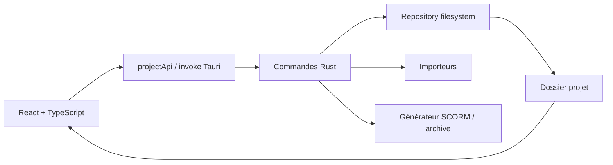

# Cartographie technique

**Produit :** PAIDEIA 
**Version de référence :** `1.0.26255` 
**État vérifié :** 12 septembre 2026 
**Statut :** implémenté

Pour la recherche opérationnelle par terme, domaine ou type d’évolution, consulter le [Dictionnaire et cartographie de maintenance](Dictionnaire_Cartographie_Maintenance.md).

## Vue d'ensemble

## Frontend

- `src/App.tsx` conserve l'orchestration globale, les états de session, les mutations et les appels Tauri.
- `src/components/lesson-editor` porte le rendu et les éditeurs inline des activités.
- `src/components/activities` contient les composants apprenants et éditeurs propres aux activités.
- `src/components/authoring` contient les primitives d'édition, le crop et l'annotation.
- `src/components/resources` et `project-library` portent les écrans de bibliothèques.
- `src/app` regroupe les services et configurations extraits de l'orchestrateur.
- `src/features/observations` porte la surcouche de relecture, son état local et son API typée ; aucune donnée d'observation n'entre dans le modèle pédagogique.
- `src/features/project-sessions/useOpenLessonSessions.ts` porte le cache mémoire des leçons ouvertes : état du projet, navigation, mode, progression d'aperçu et descripteurs de polices. Le changement d'onglet réactive cette session sans relire le projet ni afficher l'attente de chargement.

## Backend Tauri

- `commands.rs` expose les commandes, pilote les imports/exports et génère le runtime SCORM.
- `repository.rs` lit et écrit le projet, l'audit et les snapshots.
- `models.rs` reflète le modèle TypeScript avec Serde.
- `importer.rs` analyse et convertit les packages reconnus.
- `main.rs` enregistre les commandes et initialise l'application.
- `pdf_a4.rs` prépare l’export en lecture seule et enregistre le PDF atomiquement. `pdf_a4_native.rs` exécute l’hôte d’impression intégré au même binaire PAIDEIA, sans Node, avec le WebView2 fixe et un profil temporaire. Le code `nativePdfPreparation.ts` construit le modèle, prépare les médias et génère le HTML dans cette WebView ; les commandes natives conservent l’impression A4 et la pagination.
- `observations.rs` conserve les événements de relecture dans un journal distinct du contenu pédagogique.

## Canal des observations

Une leçon écrit un fichier JSON immuable par événement sous `notes/events`. Les anciens emplacements `.paideia-observations` et `observations` sont migrés automatiquement.

L’archive native `.paideia` conserve les observations. Le générateur SCORM et le PDF pédagogique n’utilisent pas ce journal.

Une purge consolide les événements dans `notes/history/purge-<horodatage>-<identifiant>.json`, puis remet l'état visible à zéro. Ces archives techniques restent dans le projet mais aucune commande ne les expose à l'interface et aucune restauration in-app n'est proposée.

## Dépendances sensibles

- **Plyr** : vidéo et audio, sous-titres et contrôles spécifiques.
- **A-Frame** : activité Image 360, hotspots et runtime SCORM dédié.
- **WebView2 fixe** : moteur de l'application Windows ; sa version est pilotée par les scripts Tauri.
- **Système de fichiers** : source de persistance ; aucune base de données applicative.

## Contrat de rendu

L'aperçu LMS React et le SCORM Rust sont deux implémentations distinctes. Toute évolution visible par l'apprenant doit vérifier les deux chemins. Le CSS d'une activité React ne modifie pas automatiquement le CSS généré par Rust.

La conception, le diagnostic et la validation de tout comportement responsive suivent la méthodologie de développement interne. Firefox/Gecko reste le navigateur de référence ; la compatibilité Edge/Chromium et la parité structurelle entre éditeur, aperçu LMS et SCORM doivent être vérifiées.

## État d'App.tsx

La décomposition a extrait le chrome, les dialogues, les bibliothèques, les réglages, le rendu de blocs, les panneaux d'activités et le JSX de l'éditeur inline. `App.tsx` reste l'orchestrateur de nombreux états, mutations et pipelines transversaux. La taille seule n'est pas un objectif ; les frontières, les tests et l'absence de duplication priment. Les garde-fous détaillés sont conservés dans la documentation de développement interne.
