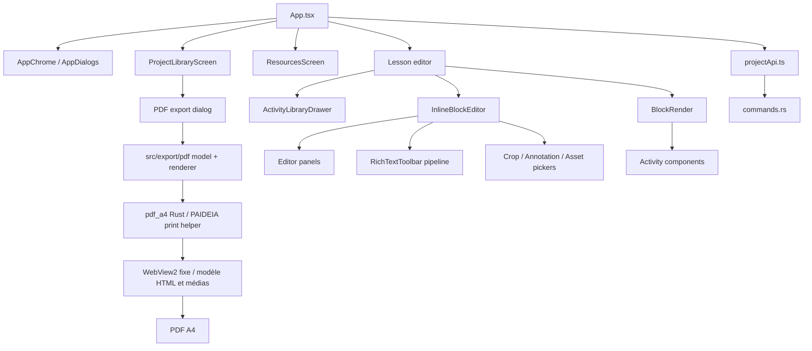

# Carte des composants

## Dépendances principales

## Frontières React

| Domaine | Composants | Responsabilité |
| --- | --- | --- |
| Application | `AppChrome`, `AppDialogs`, `ScrollBoundaryControls` | Navigation globale, modales, chrome et défilement accéléré des viewports auteur éligibles |
| Bibliothèque | `ProjectLibraryScreen`, `ProjectLibraryCards` | Leçons, collections, favoris et actions |
| Éditeur | `InlineBlockEditor`, `BlockRender`, `LessonSettingsPanel` | Composition et rendu auteur |
| Chapitres | `useChapterDuplication`, `ChapterDuplicationUi` | Tampon à usage unique, placement, conflits de médias et commandes de duplication/collage |
| Panneaux | `ContentActivityEditorPanels`, `SimpleActivityEditorPanels`, composants `*EditorPanel` | Réglages par famille |
| Activités | dossiers sous `components/activities` | Rendu apprenant et logique locale bornée |
| Rich Text | `RichTextToolbar`, dialogues lien/image | UI de commandes du pipeline central |
| Médias auteur | `AuthoringImageMediaEditor`, crop, annotation | Sélection et transformation d'images |
| Ressources | managers Character, QuestionBank, Assistant | Bibliothèques réutilisables |
| Export PDF | `PdfExportDialog`, `src/export/pdf/*`, `nativePdfPreparation.ts` | Modèle documentaire, HTML riche, médias et préparation dans la WebView dédiée |

## Contrat d'InlineBlockEditor

Le composant reçoit un contrat regroupé par domaines : modèle, médias, items, crop/annotation, renderers Rich Text et actions. Il possède les dérivations et le JSX de l'éditeur ; `App.tsx` conserve les états, uploads, mutations et appels Tauri. Cette frontière ne doit pas être contournée par de nouveaux panneaux ajoutés directement dans `App.tsx`.

## Composants Rust

| Fichier | Responsabilité |
| --- | --- |
| `models.rs` | Schéma persistant Serde |
| `repository.rs` | Transactions fichiers, audit, snapshots |
| `commands.rs` | Façade Tauri, assets, archive, SCORM, ressources |
| `importer.rs` | Import et rematching de contenus reconnus |
| `screen_color_picker.rs` | Pipette native Windows |
| `pdf_a4.rs`, `pdf_a4_native.rs` | Lecture seule du projet, hôte PDF PAIDEIA, pilotage natif du WebView2 fixe et enregistrement atomique |

## Règle de dépendance

Un composant d'activité peut dépendre des primitives auteur partagées. Il ne doit pas importer `App.tsx`, réimplémenter le Rich Text central ni écrire directement sur le système de fichiers.

`ScrollBoundaryControls` est une surcouche portalisée strictement rattachée au viewport qui lui est fourni. Son branchement est limité au viewport principal de l'éditeur hors aperçu LMS et au viewport principal de `ResourcesScreen`. Il ne doit pas être généralisé implicitement aux rendus apprenant ni aux zones de défilement internes.
