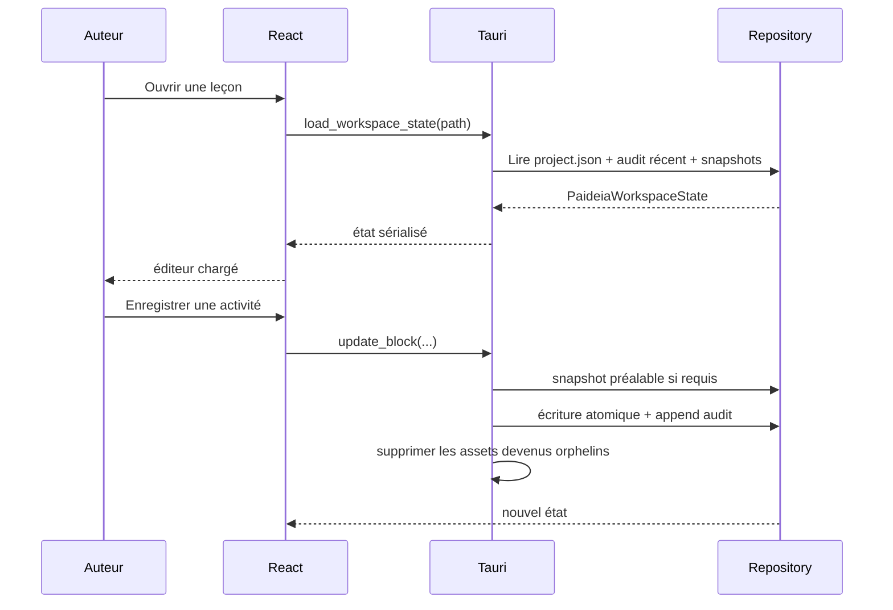
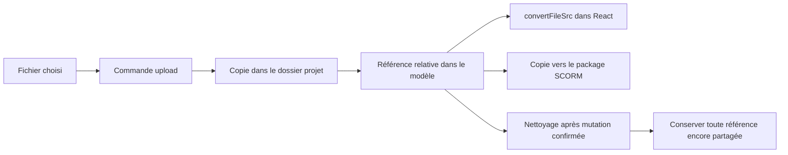
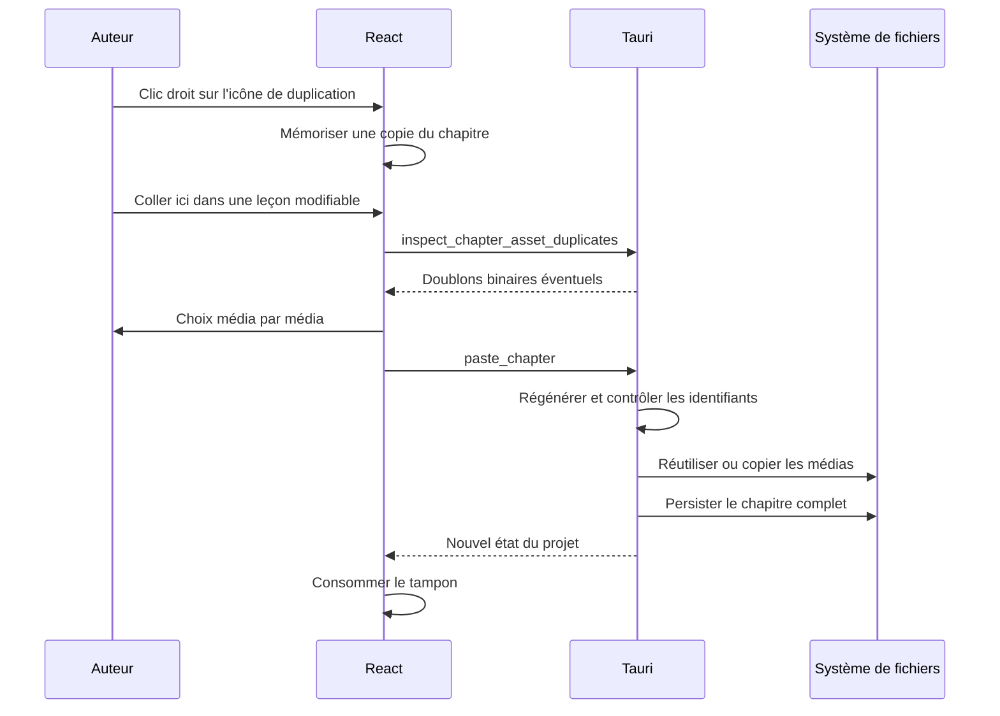
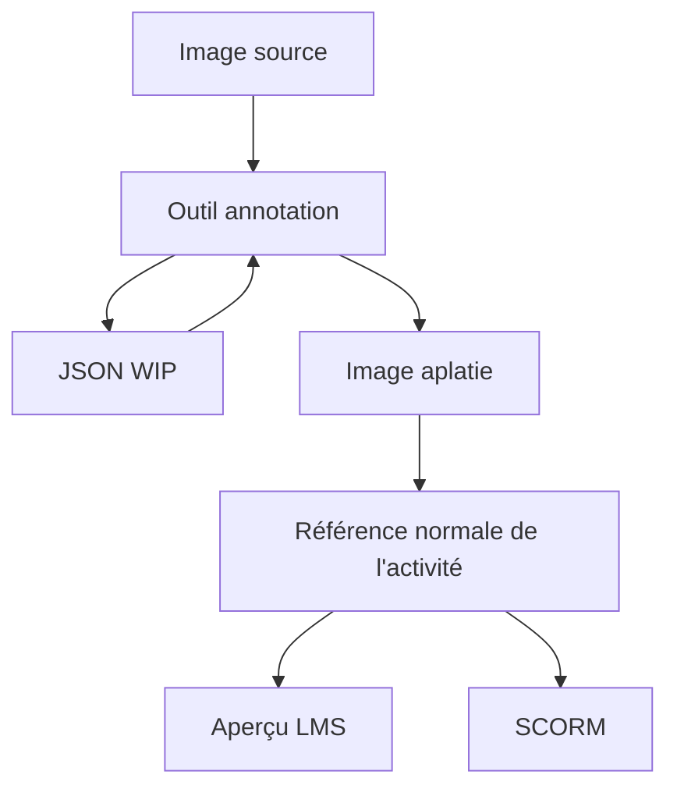
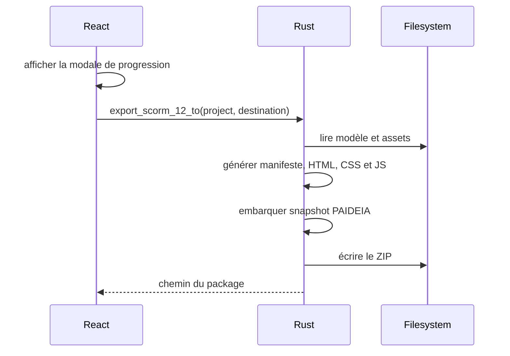
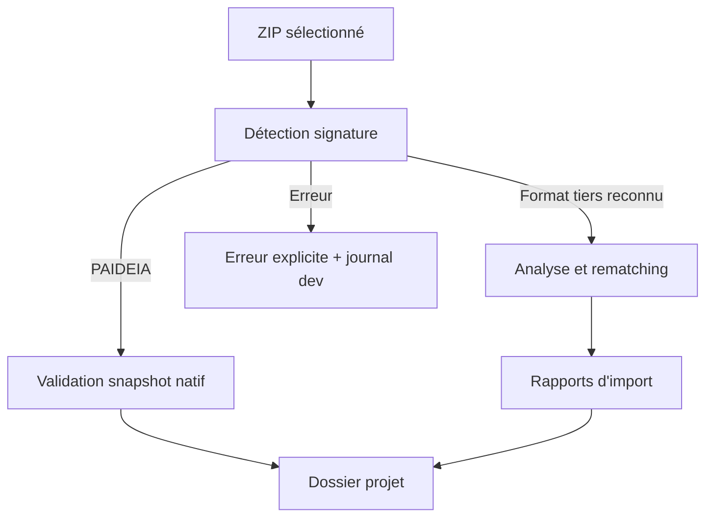

# Flux de données

## Ouverture et sauvegarde

## Asset média

## Copier-coller d'un chapitre

## Annotation

## Export SCORM

### Styles et scripts propres à l’export

Dans [`src-tauri/src/commands.rs`](../../src-tauri/src/commands.rs), `write_scorm_archive` assemble le ZIP. Rust génère le HTML et y fournit les données, les classes, les attributs et les variables CSS. Les fichiers ci-dessous séparent les règles de présentation et les interactions du code Rust. `include_str!` en lit le contenu à la compilation de PAIDEIA.

| Fichier source actuel | Intégration par l’exporteur | Contrat avec le HTML généré |
| --- | --- | --- |
| [`scorm_situational_dialogue.css`](../../src-tauri/src/scorm_situational_dialogue.css) | `build_scorm_index` l’insère dans un bloc `<style>` d’`index.html`, avec [`dialogueBanner.css`](../../src/components/activities/SituationalDialogueActivity/dialogueBanner.css), partagé avec l’interface. | Les styles ciblent notamment `.block.situational-dialogue` et utilisent des variables comme `--dialogue-action-bg` et `--situational-dialogue-radius`. |
| [`scorm_rich_references.js`](../../src-tauri/src/scorm_rich_references.js) | `build_scorm_index` intègre le script dans `index.html`. `build_scorm_runtime` l’intègre également dans `js/runtime.js` à partir de la balise de substitution `__PAIDEIA_RICH_REFERENCES__`. Les styles de défilement viennent de [`referenceScroll.css`](../../src/components/rich-text-toolbar/referenceScroll.css). | `setupRichReferences` lit les déclencheurs `data-paideia-reference-id`, les définitions et les cibles de renvoi (`data-paideia-reference-definition`, `data-paideia-bookmark-target` et `data-paideia-bookmark-id`). |

Une modification purement visuelle du SCORM se fait dans le CSS concerné. Une modification de l’ouverture, de la fermeture ou du défilement des fenêtres de renvoi se fait dans le JS et les styles concernés. Si une classe, une variable ou un attribut change, vérifier aussi le HTML produit par Rust. L’éditeur et l’aperçu LMS ont leurs propres styles et partagent certains fichiers avec l’export.

Lors d’un prochain changement sur ces fichiers, les regrouper dans `src-tauri/src/scorm/` et actualiser les trois chemins `include_str!` dans `commands.rs`. Après un déplacement ou une modification, générer et ouvrir un ZIP SCORM. Vérifier le rendu des trois modèles de « Mise en situation » aux largeurs prévues et tester les renvois (ouverture, fermeture et défilement d’un contenu long). Pour un style partagé, vérifier aussi l’aperçu LMS.

## Export PDF A4

La commande `generate_pdf_a4` lit la leçon ou extrait son archive dans un dossier temporaire. Elle lance le même exécutable PAIDEIA en mode `--pdf-a4-native`, sans démarrer l’éditeur. Rust lit les ressources du projet, la WebView invisible prépare le modèle et les médias, puis le WebView2 fixe imprime le HTML. Le pilotage utilise l’API native du moteur, sans port de débogage. La capture d’une activité HTML peut employer un serveur de fichiers temporaire limité à `127.0.0.1` et au paquet concerné.

Le PDF est écrit atomiquement à la destination choisie ; les fichiers temporaires sont supprimés ensuite. Le projet, ses journaux et ses observations ne sont pas modifiés. Node.js reste nécessaire à la compilation sur le poste de développement et n’est pas livré avec le générateur PDF.

## Import SCORM

