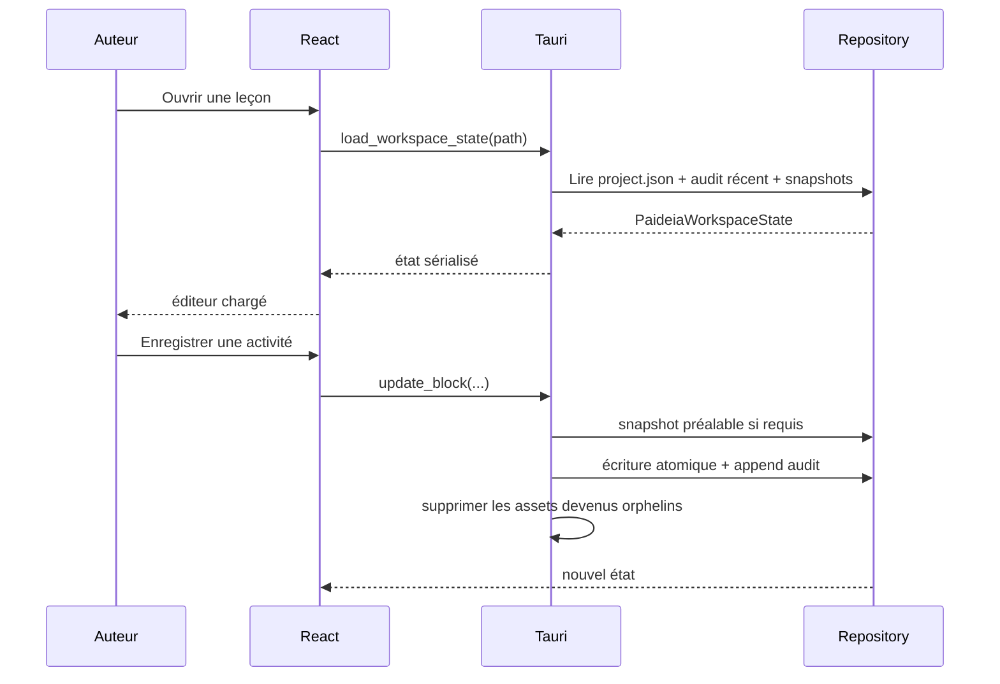
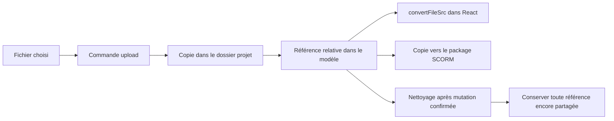
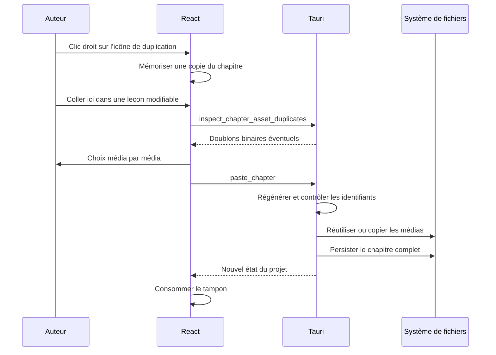
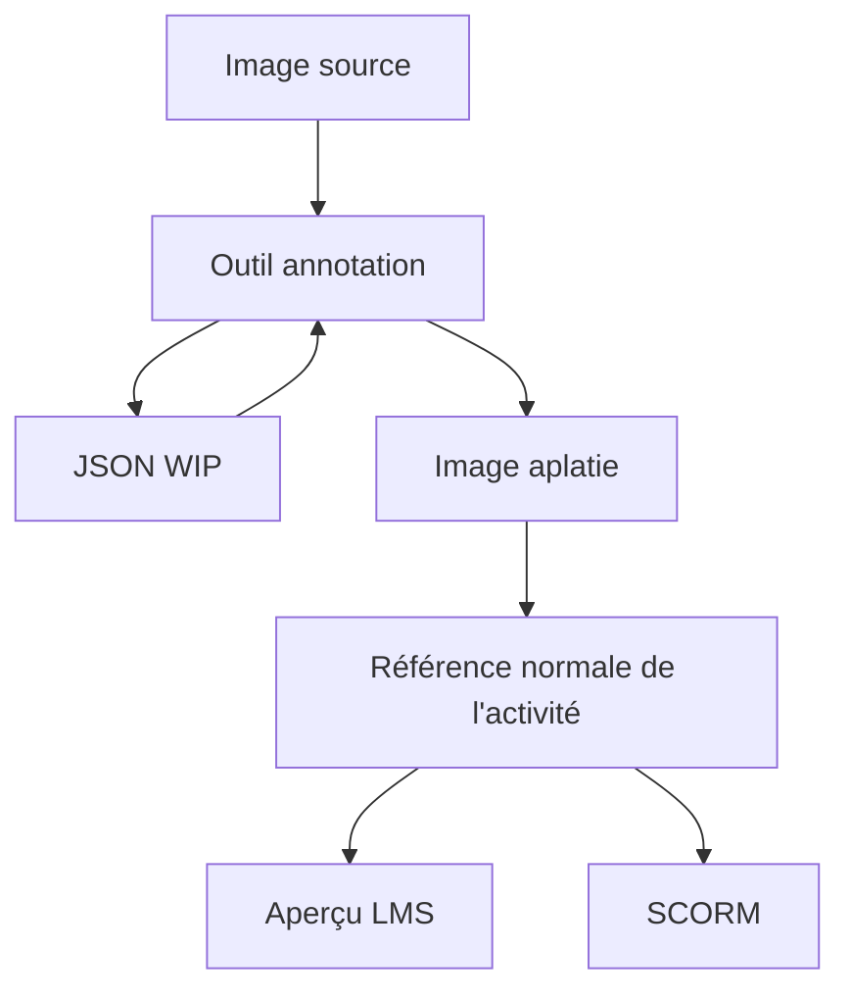
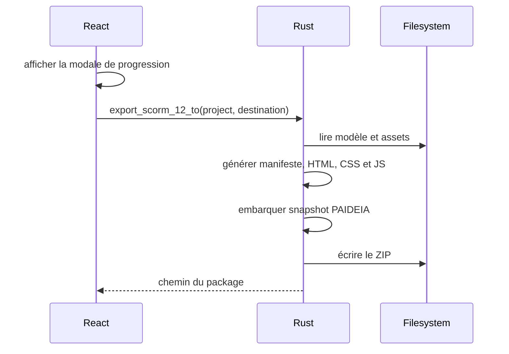
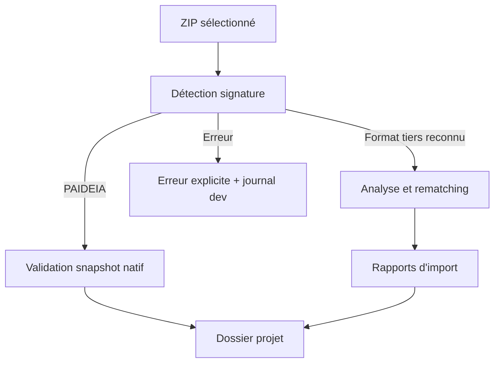

# Flux de données

## Ouverture et sauvegarde

## Asset média

## Copier-coller d'un chapitre

## Annotation

## Export SCORM

## Export PDF A4

La commande `generate_pdf_a4` lit la leçon ou extrait son archive dans un dossier temporaire. Elle lance le même exécutable PAIDEIA en mode `--pdf-a4-native`, sans démarrer l’éditeur. Rust lit les ressources du projet, la WebView invisible prépare le modèle et les médias, puis le WebView2 fixe imprime le HTML. Le pilotage utilise l’API native du moteur, sans port de débogage. La capture d’une activité HTML peut employer un serveur de fichiers temporaire limité à `127.0.0.1` et au paquet concerné.

Le PDF est écrit atomiquement à la destination choisie ; les fichiers temporaires sont supprimés ensuite. Le projet, ses journaux et ses observations ne sont pas modifiés. Node.js reste nécessaire à la compilation sur le poste de développement et n’est pas livré avec le générateur PDF.

## Import SCORM

