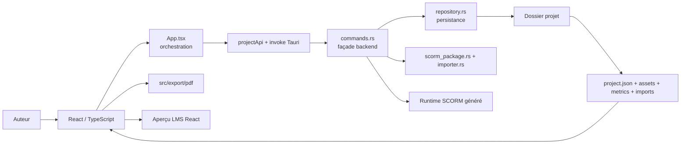
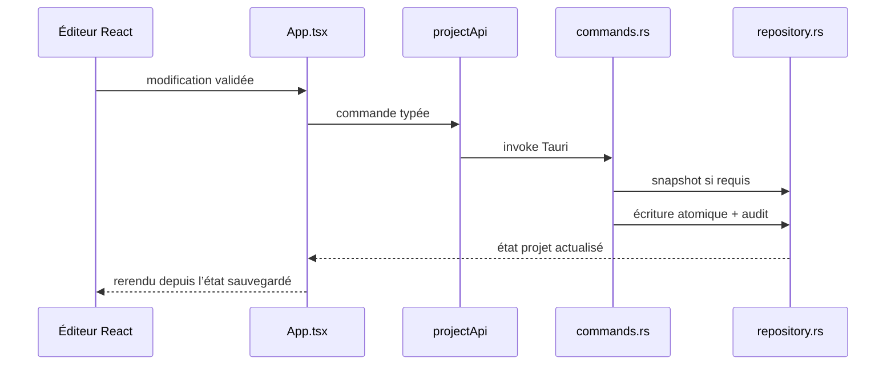
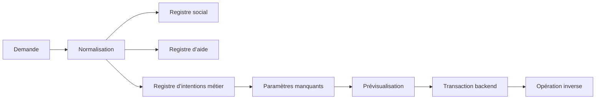

# Dictionnaire et cartographie de maintenance PAIDEIA

**Révision :** 30 août 2026
**Objet :** retrouver rapidement la source de vérité, les chemins d’exécution et les contrôles requis avant de modifier PAIDEIA.

Le code reste la référence d’exécution. Ce document ne remplace pas les fiches fonctionnelles : il indique **où chercher**, **quoi maintenir ensemble** et **comment éviter une parité partielle**.

## 1. Carte générale

Trois sorties apprenant sont distinctes :

1. aperçu LMS React ;
2. package SCORM généré par Rust ;
3. PDF de relecture généré par le pipeline PDF frontend.

Une évolution visible n’est complète que lorsque les sorties concernées respectent le même contrat.

## 2. Dictionnaire du modèle

| Terme | Sens dans PAIDEIA | Source principale |
|---|---|---|
| Projet | Dossier persistant d’une leçon et de ses ressources | `src/types/project.ts`, `src-tauri/src/models.rs` |
| Leçon | Contenu pédagogique ouvert dans l’éditeur ; correspond au projet métier | modèle projet, `App.tsx` |
| Module | Niveau structurel supérieur conservé dans le modèle | `project.ts`, `models.rs` |
| Chapitre | Regroupement ordonné de pages et d’activités dans une leçon | `project.ts`, sélecteurs dans `src/app/projectSelectors.ts` |
| Page | Conteneur persistant des blocs d’un chapitre | `project.ts`, `models.rs` |
| Bloc | Unité persistante générique identifiée par `type` | `PaideiaBlock` dans `project.ts` et miroir Rust |
| Activité | Interprétation métier et UI d’un bloc | `src/app/libraryConfig.ts`, `components/activities` |
| Item d’activité | Élément interne d’une activité structurée | `components/activities/activityItems.ts`, types dédiés |
| `blockType` | Identifiant technique canonique d’une activité, par exemple `media` ou `image-text` | catalogue de bibliothèque et modèle |
| Asset | Fichier copié dans le dossier projet et référencé par un chemin relatif | `src/app/mediaAssets.ts`, `src/app/assetUrls.ts`, commandes Rust |
| `assetRef` | Référence persistante vers un asset ; ce n’est pas le nom affiché | `project.ts`, `models.rs` |
| Snapshot | Copie de sécurité bornée créée avant certaines mutations | `repository.rs` |
| Audit | Journal des mutations du projet | `repository.rs`, appels depuis `commands.rs` |
| Métrique | Diagnostic ou résultat calculé placé dans `metrics/` | commandes Rust et services concernés |
| Roundtrip PAIDEIA | Réimport d’un SCORM PAIDEIA avec restauration du snapshot natif | `commands.rs`, snapshot exporté |
| Import tiers reconnu | Extraction et rematching d’un paquet vers des activités natives | `scorm_package.rs`, `importer.rs` |
| Rematching | Conversion d’une structure source reconnue vers le modèle PAIDEIA | `importer.rs` |
| Aperçu LMS | Runtime React de contrôle dans l’application | `BlockRender.tsx`, composants d’activité |
| Runtime SCORM | HTML, CSS et JavaScript autonomes générés à l’export | `commands.rs` |
| PDF de relecture | Représentation éditoriale statique, non équivalente à un runtime interactif | `src/export/pdf` |
| Arion | Assistant déterministe de conception et d’aide | `src/features/designer-actions` |

## 3. Sources de vérité

| Sujet | Source de vérité | Ne pas recréer ailleurs |
|---|---|---|
| Types et champs persistants frontend | `src/types/project.ts` | interfaces locales divergentes |
| Miroir persistant backend | `src-tauri/src/models.rs` | structures ad hoc dans les commandes |
| Catalogue des activités disponibles | `src/app/libraryConfig.ts` | listes manuelles dans `App.tsx` |
| Libellé d’un type d’activité | `src/app/activityLabels.ts` + locales | `switch` de textes dispersés |
| Apparence commune de fond | `src/app/activityAppearanceCapabilities.ts` | listes frontend/backend indépendantes |
| Connaissances documentaires d’Arion | `designerKnowledgeCatalog.ts` | faits écrits dans le parseur ou `App.tsx` |
| Conversations sociales | `designerSocialRegistry.ts` | regex ou réponses dans `App.tsx` |
| Intentions et gabarits d’aide | `designerHelpRegistry.ts` | formulations dans `designerHelpEngine.ts` |
| Capacités exécutables d’Arion | `designerCapabilityRegistry.ts` | suggestions sans capacité réelle |
| Intentions d’action Arion | `designerIntentRegistry.ts` | parseurs parallèles |
| Paramètres manquants d’Arion | `designerSlotRegistry.ts` | questions codées dans le panneau |
| Localisation UI | `src/locales/*.json` | chaînes utilisateur dans les composants |
| Évaluation d’une activité | fichier `*Evaluation.ts` du dossier de l’activité | calcul dupliqué dans l’éditeur |
| Contrat PDF | `src/export/pdf/activityPdfMatrix.ts` et modèle PDF | rendu improvisé depuis l’UI |
| Persistance et rétention | `repository.rs` | écritures directes depuis le frontend |

## 4. Frontières du frontend

| Zone | Responsabilité | Exemples |
|---|---|---|
| `src/App.tsx` | Orchestration globale, états de session, coordination des mutations et dialogues transversaux | ouverture, sauvegarde, sélection, appels Tauri |
| `src/app` | Services, configurations et sélecteurs sans JSX métier lourd | assets, apparence, durée, bibliothèque |
| `src/components/app` | Chrome et dialogues d’application | `AppChrome`, `AppDialogs`, export PDF |
| `src/components/lesson-editor` | Composition de l’éditeur, rendu des blocs et panneaux communs | `InlineBlockEditor`, `BlockRender` |
| `src/components/activities` | Contrat local d’une activité : runtime, éditeur, types, valeurs par défaut et styles | `VideoActivity`, `TabsActivity` |
| `src/components/authoring` | Primitives auteur réutilisables | sélection de média, annotation, contrôles |
| `src/components/rich-text-*` | Pipeline Rich Text commun, tableaux et barre d’outils | `RichTextToolbar`, contrôleur de tableau |
| `src/components/resources` | Gestion des banques réutilisables | personnages, questions, assistant |
| `src/features` | Fonctions transversales isolées avec leur modèle et leurs registres | assistant Arion |
| `src/export/pdf` | Modèle, préparation des assets et génération PDF | worker et matrice PDF |
| `src/i18n` et `src/locales` | Traduction et dictionnaires | `createTranslator`, fichiers JSON |
| `src/lib` | Adaptateurs techniques et utilitaires transversaux | Tauri, entités HTML, accessibilité image |

### Règle pour `App.tsx`

`App.tsx` peut coordonner un domaine mais ne doit pas contenir son catalogue, ses variantes de texte, son modèle local ou son rendu détaillé. Une évolution qui ajoute une longue table, une famille de regex ou un panneau métier dans `App.tsx` doit être arrêtée et extraite dans le domaine concerné.

Les garde-fous détaillés d’`App.tsx` sont conservés dans la documentation de développement interne.

## 5. Frontières du backend

| Fichier | Responsabilité |
|---|---|
| `main.rs` | Initialisation Tauri et enregistrement des commandes |
| `commands.rs` | Façade des commandes, orchestration backend, assets, exports et transactions métier |
| `models.rs` | Miroir Serde du modèle persistant |
| `repository.rs` | Lecture, écriture atomique, audit, snapshots et rétention |
| `scorm_package.rs` | Contrôle et découverte technique d’un paquet SCORM avant rematching |
| `importer.rs` | Analyse du contenu reconnu et conversion vers les activités PAIDEIA |
| `whisper.rs` | Intégration locale de la génération de sous-titres |
| `screen_color_picker.rs` | Pipette native Windows |

Une commande Tauri est enregistrée dans `main.rs`, exposée par un adaptateur TypeScript — généralement `src/lib/projectApi.ts` — puis appelée par l’orchestrateur ou le service frontend concerné.

## 6. Cycle complet d’une activité

Créer ou modifier structurellement une activité peut toucher les points suivants :

| Étape | Emplacement |
|---|---|
| Déclaration dans la bibliothèque | `src/app/libraryConfig.ts` |
| Libellé localisé | `src/app/activityLabels.ts`, `src/locales/*.json` |
| Type persistant frontend | `src/types/project.ts` |
| Type persistant Rust | `src-tauri/src/models.rs` |
| Valeurs initiales | dossier de l’activité, fichier `defaults.ts` ou équivalent |
| Rendu apprenant React | `*Activity.tsx` |
| Éditeur auteur | `*ActivityEditor.tsx` et éventuel `*EditorPanel.tsx` |
| Styles React | `*Activity.module.css` |
| Branchement dans l’éditeur | `InlineBlockEditor.tsx` et panneaux de `lesson-editor` |
| Branchement dans l’aperçu | `BlockRender.tsx` |
| Persistance des mutations | commandes Rust concernées |
| Rendu SCORM | générateur dans `commands.rs` |
| Export PDF | `activityPdfMatrix.ts`, `buildLessonPdfModel.ts`, rendu PDF |
| Import/rematching | `importer.rs` si le format source est reconnu |
| Assets et nettoyage | collecte frontend/backend des références |
| Estimation de durée | `src/app/lessonDuration.ts` si l’activité est quantifiable |
| Accessibilité | ALT, clavier, focus et sémantique selon le type |
| Documentation | fiche d'activité dans la documentation de développement interne |

Tous ces points ne sont pas requis pour une simple correction locale, mais ils doivent être explicitement examinés.

## 7. Où intervenir selon la demande

| Demande | Point d’entrée | Vérifications minimales |
|---|---|---|
| Ajouter un champ persistant | `project.ts`, `models.rs`, commande de mise à jour | ouverture, sauvegarde, ancien projet, roundtrip |
| Modifier un rendu d’activité | dossier `components/activities/<Activité>` | éditeur, aperçu LMS, SCORM, responsive |
| Modifier une interaction évaluée | types, defaults et `*Evaluation.ts` | score, tentatives, progression, SCORM |
| Ajouter une option d’apparence commune | contrôles communs + registre de capacités | persistance, React, SCORM, Arion |
| Modifier le Rich Text | composants `rich-text-toolbar` / `rich-text-table` | sélection, caret, WebView fixe, SCORM, PDF |
| Ajouter un asset média | service assets + commande Rust | copie, référence relative, export, suppression orpheline |
| Modifier l’import SCORM | `scorm_package.rs` ou `importer.rs` selon la couche | sécurité, formats historiques, rapport, roundtrip |
| Modifier l’export SCORM | `commands.rs` | manifeste, runtime, assets, snapshot natif |
| Modifier le PDF | `src/export/pdf` | modèle, worker, médias, pagination |
| Ajouter une clé UI | `fr.json`, puis autres locales requises | `test:locales` |
| Enrichir Arion social | `designerSocialRegistry.ts` | exemples, locale, effet local éventuel |
| Enrichir l’aide Arion | registres help + knowledge catalog | déterminisme, faits réels, guide généré |
| Ajouter une action Arion | capacité, intention, slots, backend transactionnel | suggestion, complément, preview, appliquer, annuler |
| Modifier le calcul de durée | `lessonDuration.ts` + commande de rapport | signature, invalidation, rapport courant |
| Modifier snapshots/audit | `repository.rs` | atomicité, rétention, restauration |

## 8. Flux sensibles

### 8.1 Mutation d’un bloc

Le frontend ne doit pas considérer une mutation persistée tant que le nouvel état backend n’a pas été reçu.

### 8.2 Asset importé

Le nom affiché, le chemin source et l’`assetRef` ont des rôles différents. Une résolution par simple nom de fichier est insuffisante lorsque plusieurs dossiers sources contiennent des homonymes. L’import conserve un chemin source injectif et remappe chaque référence vers son asset copié.

### 8.3 Action Arion

Une suggestion ne constitue jamais une autorisation. Seule une capacité déclarée et validée par le backend peut produire une mutation.

## 9. Parités obligatoires

| Évolution | Chemins à comparer |
|---|---|
| Présentation visuelle d’une activité | éditeur, aperçu LMS, SCORM |
| Donnée persistante | TypeScript, Rust, sauvegarde, réouverture |
| Média | éditeur, aperçu, SCORM, nettoyage, roundtrip |
| Contenu Rich Text | éditeur, aperçu, SCORM, PDF si pertinent |
| Interaction évaluée | React, SCORM, score, tentatives, progression |
| Localisation | FR, locales complètes concernées, placeholders |
| Action Arion | analyse, question, prévisualisation, application, annulation |
| Import | paquet source, projet créé, rapport, réexport et réouverture |

Le PDF peut volontairement simplifier une interaction, mais cette différence doit être décrite dans la fiche de l’activité.

## 10. Tests et commandes de contrôle

| Domaine | Commande |
|---|---|
| Build frontend | `npm.cmd run build` |
| TypeScript seul | `.\node_modules\.bin\tsc.cmd --noEmit` |
| Locales | `npm.cmd run test:locales` |
| Arion | `npm.cmd run test:designer-actions` |
| Durée | `npm.cmd run test:lesson-duration` |
| Modèle PDF | `npm.cmd run test:pdf-model` |
| Backend Rust | `cargo check` dans `src-tauri` |
| Guide d’aide Arion | `npm.cmd run docs:arion-help` |

Le build Vite signale actuellement la taille de certains chunks. Cet avertissement n’est pas une preuve d’échec fonctionnel, mais doit rester visible dans les comptes rendus de validation.

## 11. Documentation associée

| Sujet | Document |
|---|---|
| Carte fonctionnelle | Documentation de développement interne |
| Carte technique synthétique | [Cartographie technique](Cartographie_Technique.md) |
| Composants | [Component Map](Component_Map.md) |
| Flux | [Data Flow](Data_Flow.md) |
| Persistance | Documentation de développement interne |
| Activités | Documentation de développement interne |
| SCORM | Documentation de développement interne |
| Arion | Documentation de développement interne |
| Social et aide Arion | Documentation de développement interne |
| Qualité | Documentation de développement interne |

## 12. Règle de maintenance de cette carte

Toute évolution structurante doit mettre à jour cette cartographie lorsqu’elle :

- crée une nouvelle source de vérité ;
- déplace une responsabilité entre fichiers ou couches ;
- ajoute un nouveau runtime ou une nouvelle sortie ;
- change le cycle de persistance ;
- ajoute un nouveau test contractuel ;
- rend obsolète un chemin indiqué dans les tableaux précédents.

Une carte de maintenance périmée est plus dangereuse qu’une carte courte. Toute ligne non vérifiable dans le code doit être corrigée ou retirée.
